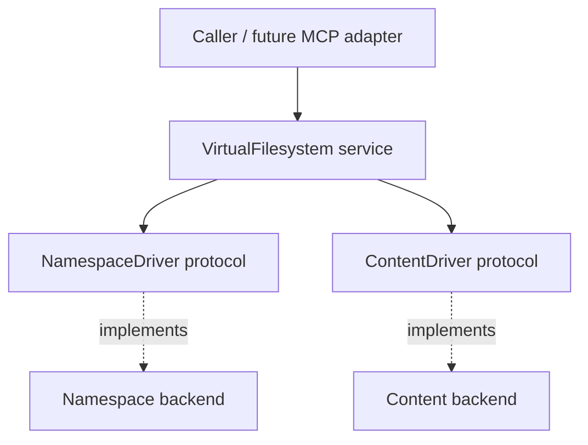
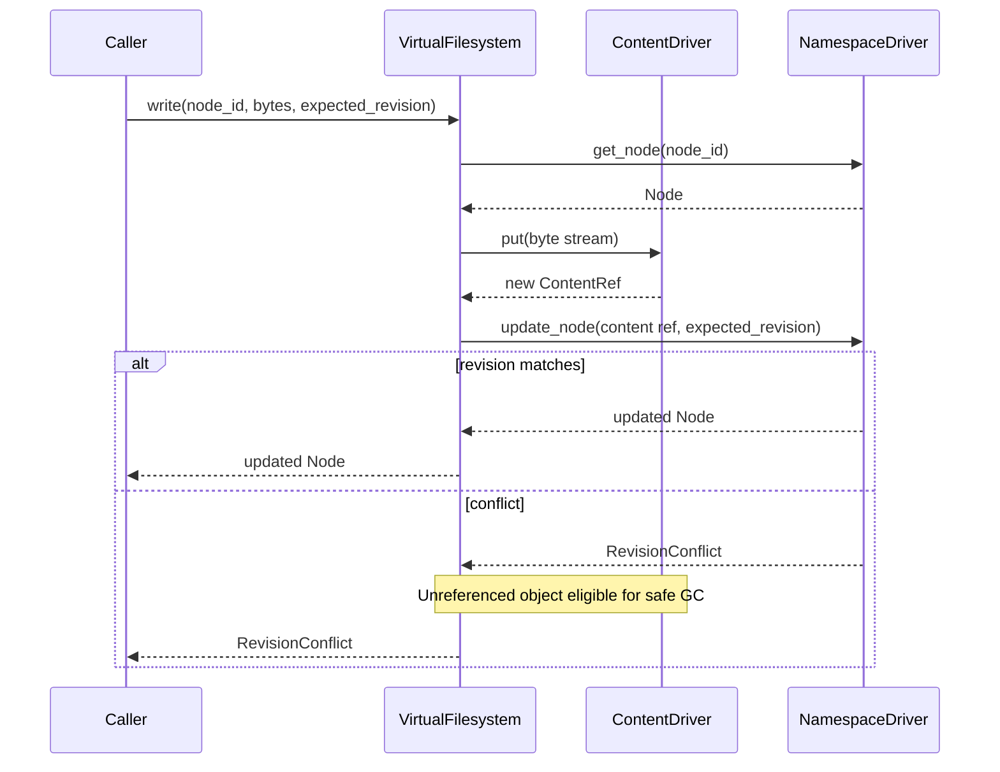
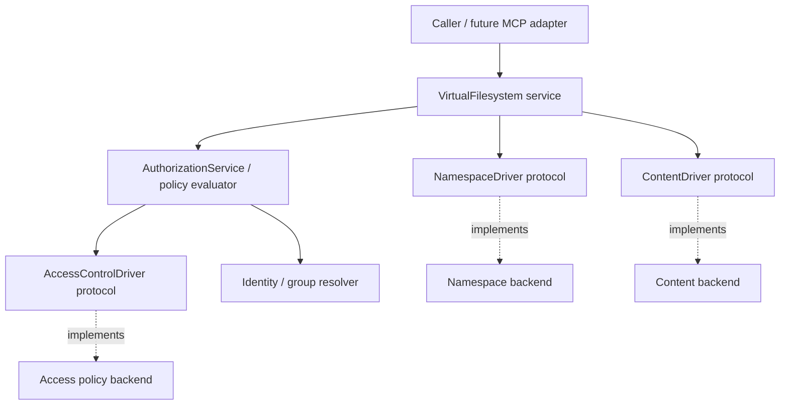
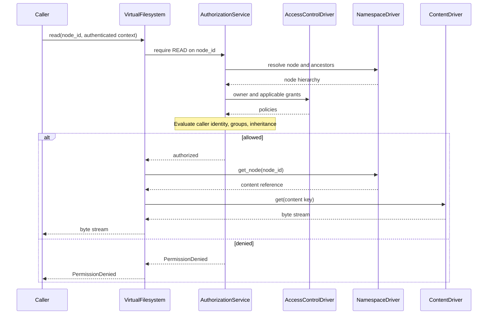

# Umbod Virtual Filesystem — Driver Design (v0.2)

## Goal

Provide a storage-agnostic virtual filesystem with nested directories and files. Logical organization and metadata are independent of the storage of file bytes. Concrete drivers (e.g. local filesystem, S3) are out of scope.

## Architecture



The service coordinates metadata and content operations. Drivers do not depend on one another.

## Models (Pydantic v2)

```python
from datetime import datetime
from enum import StrEnum
from uuid import UUID
from pydantic import BaseModel, Field

NodeId = UUID
StorageKey = str

class NodeKind(StrEnum):
    FILE = "file"
    DIRECTORY = "directory"

class ContentRef(BaseModel):
    key: StorageKey  # opaque, immutable content object
    size: int = Field(ge=0)
    checksum: str | None = None

class NodeMetadata(BaseModel):
    content_type: str | None = None
    attributes: dict[str, str] = Field(default_factory=dict)

class Node(BaseModel):
    id: NodeId
    parent_id: NodeId | None
    name: str
    kind: NodeKind
    metadata: NodeMetadata = Field(default_factory=NodeMetadata)
    content: ContentRef | None = None
    created_at: datetime
    updated_at: datetime
    revision: int = Field(ge=1)
```

Paths are derived from `parent_id` and `name`; a node's ID survives moves and renames. Only files may have content references.

## Low-level protocols

```python
from collections.abc import AsyncIterator, Sequence
from typing import Protocol

ByteStream = AsyncIterator[bytes]

class NamespaceDriver(Protocol):
    async def get_node(self, node_id: NodeId) -> Node: ...
    async def get_child(self, parent_id: NodeId, name: str) -> Node | None: ...
    async def list_children(self, parent_id: NodeId) -> Sequence[Node]: ...
    async def create_node(
        self, parent_id: NodeId, name: str, kind: NodeKind,
        metadata: NodeMetadata | None = None,
        content: ContentRef | None = None,
    ) -> Node: ...
    async def update_node(
        self, node_id: NodeId, *,
        metadata: NodeMetadata | None = None,
        content: ContentRef | None = None,
        expected_revision: int,
    ) -> Node: ...
    async def move_node(
        self, node_id: NodeId, new_parent_id: NodeId, new_name: str,
        *, expected_revision: int,
    ) -> Node: ...
    async def delete_node(
        self, node_id: NodeId, *, expected_revision: int,
    ) -> None: ...

class ContentDriver(Protocol):
    async def put(self, data: ByteStream) -> ContentRef: ...
    def get(self, key: StorageKey) -> ByteStream: ...
    async def delete(self, key: StorageKey) -> None: ...
```

`update_node` is provisional: before implementation, use an explicit patch model or sentinel to distinguish omitted fields from clearing a content reference.

## Write lifecycle



Content objects are immutable. Replacing a file creates a new object and atomically updates its namespace reference. Unreferenced objects require deferred, concurrency-safe garbage collection.

## Required invariants

- Exactly one root (`parent_id=None`); root cannot be moved or deleted.
- Names are single path components; sibling names are unique.
- Parents must exist and be directories; moves cannot create cycles.
- Directories have no content; files may initially have none.
- Deleting a nonempty directory fails; recursive deletion is not part of v0.1.
- Namespace mutations are atomic and use optimistic revision checks.
- A successful content `put` yields a complete, readable object.

## Out of scope

Authorization, OAuth groups, CapabilitySets, MCP exposure, concrete adapters, symlinks, recursive deletion, locking, notifications, indexing, and cross-driver transactions.

## Ownership and sharing (v0.2 extension)

Add an independent `AccessControlDriver` for persisted ownership and sharing policies. It references logical nodes, **not** content keys; two nodes pointing to identical bytes can have different access policies.



### Models (Pydantic v2)

```python
class PrincipalType(StrEnum):
    USER = "user"
    GROUP = "group"

class Principal(BaseModel):
    type: PrincipalType
    issuer: str  # identity-provider issuer; include tenant where applicable
    id: str      # stable provider-specific identifier

class Permission(StrEnum):
    DISCOVER = "discover"
    READ = "read"
    WRITE = "write"
    DELETE = "delete"
    SHARE = "share"

class Ownership(BaseModel):
    node_id: NodeId
    owner: Principal

class AccessGrant(BaseModel):
    node_id: NodeId
    principal: Principal
    permissions: set[Permission]
    recursive: bool = False
```

### Low-level access-control protocol

```python
class AccessControlDriver(Protocol):
    async def get_owner(self, node_id: NodeId) -> Ownership: ...
    async def set_owner(self, ownership: Ownership) -> None: ...
    async def list_grants(self, node_id: NodeId) -> Sequence[AccessGrant]: ...
    async def add_grant(self, grant: AccessGrant) -> None: ...
    async def remove_grant(
        self, node_id: NodeId, principal: Principal,
    ) -> None: ...
```

The driver persists policies; it does **not** resolve group membership or decide authorization. `AuthorizationService` evaluates direct and inherited grants against the authenticated caller and trusted group memberships. Default deny applies when ownership/policy records are missing. Mutating grants or ownership requires authorization at the service layer.

### Authorized read lifecycle



### Consistency and security rules

- Ownership and shares are attached to stable `NodeId`, never paths or `StorageKey`.
- Directory grants can be inherited; inheritance must not permit a directory owner to grant access to descendants they lack authority to share.
- Moves into shared directories must not silently broaden access beyond the actor's delegation rights.
- Creating a node and assigning its owner span drivers: use fail-closed access plus compensation/reconciliation if ownership creation fails.
- Deletion must eventually clean up grants and unreferenced content; cross-driver atomic transactions are not assumed.
- The service checks authorization before namespace/content operations; storage drivers are not exposed directly to untrusted callers.
- Future generalization: replace `NodeId` with a typed `ResourceId` if access control is shared across Umbod CapabilitySets, tools, and other primitives.

Concrete access-policy backends, OAuth integration, and full policy evaluation algorithms remain out of scope.
