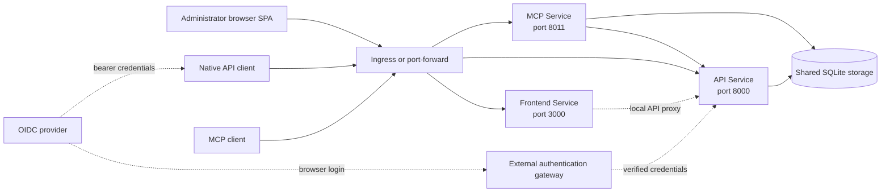

# Service topology

By default, the Helm chart deploys Umbod as a core Pod and a frontend Pod. The core Pod runs the API and MCP containers with shared SQLite storage. Optional `telemetry.enabled` adds a private collector listener to the existing API process and a ClusterIP Service targeting it.

## Runtime services

| Service | Responsibility | Service port |
| --- | --- | ---: |
| `frontend` | Static SvelteKit SPA assets, public runtime configuration, and local API routing; no Node runtime | 3000 |
| `api` | REST API, configuration, administration, and persistence | 8000 |
| `mcp` | MCP endpoint and agent-facing tools | 8011 |
| `telemetry` (optional) | Collector-only OTLP HTTP endpoints in the API process | 4318 |

Separate [administrator MCP hosting](admin-mcp.md#hosting-and-deployment) is the default, runs in the existing MCP process, and adds only a private ClusterIP Service on port `8013`. It never runs in API or adds a Deployment. Explicit shared hosting creates no additional listener or Service; feature disablement independently prevents administrator registration and the separate listener.

The API exposes metrics in the core Pod on port `8001`. The MCP container exposes metrics on port `8012`.

## Workloads and storage

The chart runs API and MCP as containers in one fixed, single-replica core Deployment. Both containers mount the same data volume at `/app/data`. The frontend runs in a separate Deployment.

`umbod api serve` runs public REST and the optional private collector in one process and event loop. The host creates and readies one shared analytics runtime for collector writes and administrator reads, then closes it after both listener lifespans drain. The parent enters each ASGI lifespan and forwards yielded state. Both enabled primary listeners must start before readiness succeeds; startup failure or an unexpected exit stops siblings. The separate embedded Prometheus listener remains signal-free, with host-owned shutdown handling. Development `--reload` adds a Uvicorn ChangeReload watcher; one serving child PID owns both HTTP ports. A failed child waits for the next edit under standard reloader behavior.

Helm controls collector listener and Service ports and the dedicated bearer Secret reference. That key is injected only into API, not MCP. There is no separate collector Deployment, image, PVC, or analytics configuration. `config.telemetryAnalytics` configures the shared runtime and core persistence controls its separate SQLite file on the data volume. See [telemetry ingestion](../reference/telemetry-ingestion.md#helm-collector-deployment).

For external deployments, `umbod telemetry serve` remains an independent collector-only process with its own analytics lifecycle. Its separate SQLite history is not automatically visible to REST administrator queries.

Without persistence, the chart uses an ephemeral `emptyDir` volume. With `persistence.enabled=true`, it mounts a ReadWriteOnce PersistentVolumeClaim. Umbod does not migrate SQLite schemas or persisted documents between incompatible versions.

The filesystem keeps namespace, ownership, and access grants in the application database. File bytes use local content storage by default, or the S3 backend in images containing that feature. API and MCP must use the same content storage configuration. S3 does not remove the need to persist the database, and file transfers still pass through Umbod. See [Files](../using-umbod/files.md) and [S3 file-content storage](s3-file-storage.md).

## Traffic boundaries

- Browsers load static assets from the frontend Service and make requests to `/api/admin` directly. Production Ingress routes `/api` to the Python API without stripping the prefix.
- Local frontend port-forwards and Docker Compose use an nginx API proxy so browser requests remain same-origin. This proxy performs no application operations.
- OTLP clients reach `/v1/*` only through the private collector listener, exposed by the collector ClusterIP Service when `telemetry.enabled=true`. Public REST and Ingress do not expose ingestion.
- Compose forwards the collector only on `127.0.0.1:14318` to container port 4318. Bind addresses select interfaces, not authorization. Private Tailscale exposure requires separately configured Serve and ACLs, not Funnel; Umbod does not configure Tailscale.
- Native clients use `/api/admin` with bearer credentials. The Python API does not mount legacy `/admin` routes.
- The Python API owns authorization, persistence, and connector setup. Browser route guards are not an authorization boundary.
- Shared installations supply an external authentication gateway for browser login and credential forwarding. The chart does not install this gateway. API failures must remain JSON responses rather than redirects to login HTML.
- Cookie-bearing mutations require a trusted `Origin` and `X-Umbod-Web-Request: 1`; native bearer requests without cookies do not use the browser CSRF contract.
- MCP clients reach the MCP Service through the configured public origin. Administrative authentication must not blanket-protect MCP OAuth discovery or OTLP routes.
- `/app-config.json` contains only browser-visible API and MCP addresses and public Auth0/logout configuration. Static assets contain no backend credentials or private environment configuration.

## Compose browser authentication

The optional `auth` Compose profile uses the pinned OAuth2 Proxy v7.6 gateway. Traefik routes browser pages to this gateway, which proxies authenticated requests to `frontend:3000`; it does not replace a 401 with a login HTML body. `/api/` retains higher-priority direct Python routing with only `/oauth2/auth` forward authentication. Missing sessions return 401 without a login redirect. Browser-page, API, and OAuth routers strip gateway credential and identity response headers before returning responses to browsers. On API routers, response stripping wraps forward authentication so denied authentication responses are also sanitized; internal forward-authentication credential propagation remains unchanged. OAuth endpoints have highest priority, while favicon paths and exactly `/signed-out.html` go directly to the frontend without authentication.

The inline `oauth2-proxy-alpha` Compose config defines the OIDC provider, frontend upstream and credential headers. It fixes the authorization audience to `UMBOD_OIDC_AUDIENCE` without caller overrides, preserves `X-Auth-Request-Access-Token` for backend validation, and puts access tokens in Authorization. ID tokens travel only through `X-Auth-Request-ID-Token`, which all browser-facing authenticated routes strip from responses. The API can optionally use that dedicated header under the [profile enrichment contract](configuration.md#optional-user-profile-enrichment), never for access authorization. Do not mix alpha options with removed legacy provider, upstream or header flags. Backend issuer, audience and administrator-membership checks remain independent and unchanged.

Logout visits `/oauth2/sign_out` with an encoded `rd` pointing to the configured Auth0 `/v2/logout` endpoint, configured client ID and fixed signed-out return URL. Register that URL in Auth0 **Allowed Logout URLs**; production uses `https://umbod-admin.computerlove.tech/signed-out.html`. Set `UMBOD_PUBLIC_SITE_ORIGIN` without a trailing slash and `UMBOD_PUBLIC_SITE_HOST` to its exact host, including a nonstandard port. The redirect allowlist includes only that host and the configured `UMBOD_OIDC_DOMAIN`. Logout clears the gateway cookie and Auth0 application session; it does not revoke existing tokens or promise logout from other identity-provider sessions.

Production frontend `PUBLIC_AUTH0_DOMAIN`, `PUBLIC_AUTH0_CLIENT_ID` and `PUBLIC_LOGOUT_RETURN_URL` are browser-visible values derived from the gateway deployment settings, not backend secrets. Local Compose defaults all three to empty, generating `logout: null` and gateway-only logout. Optional full Auth0 logout locally requires explicitly setting all three public variables to the actual configured Auth0 domain/client and an HTTPS `/signed-out.html` return URL registered in Auth0 Allowed Logout URLs. Default local development still accesses the frontend directly at port 3010 without starting the auth profile. Shared authenticated installations require correct public origins, callback registration, logout registration and proxy secrets. Compose validation must use `config --quiet` to avoid printing resolved secrets.

See [Endpoints and ports](../reference/endpoints-and-ports.md) for service ports and local access commands.
